# Variables Ultra

Rebind, import and export Figma variables, and generate Material 3 themes.

English | [中文](README_ZH.md)

**Variables Ultra** is a free Figma plugin for working with variables. It covers most of what Figma's built-in
variables panel does, with a layout tuned for large collections, and adds tools Figma doesn't have: rebinding layers
from one collection to another, moving variables between files, and generating Material 3 color themes.

- Every feature is free. No account or sign-in is needed.
- Everything runs inside Figma. Exports are saved as a local file and nothing is uploaded.

## Contents

- [Variables tab](#variables-tab)
- [Rebind variables](#rebind-variables)
- [Import and export](#import-and-export)
- [Material 3 templates](#material-3-templates)
- [Feedback](#feedback)

## Variables tab

Open the plugin to browse and edit the variables in the current file.

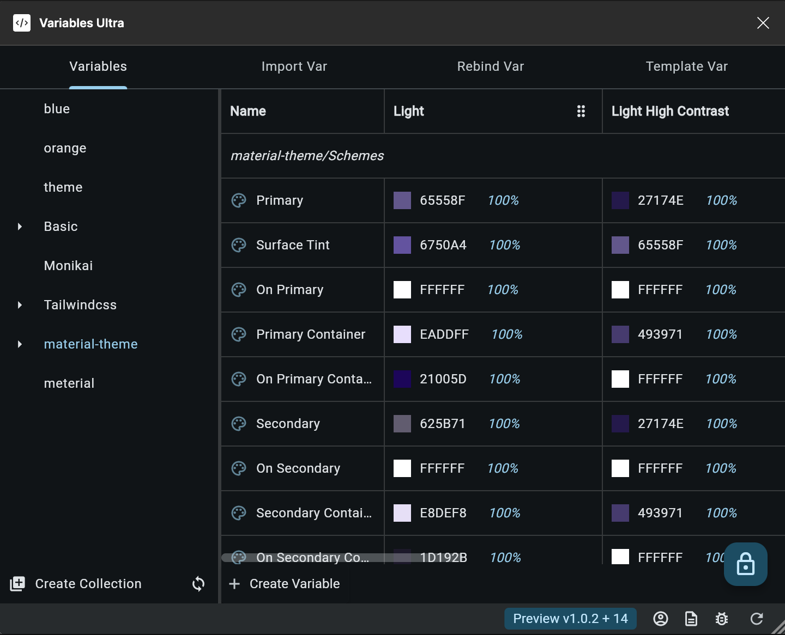

- All collections sit side by side in one view, so you switch between them without a dropdown.
- Click the icon in front of a variable's name to view or edit its details.
- Select one, several or all variables at once.
- Link a variable to another one (an alias) in fewer steps.
- Change the scopes of many variables in one go.

## Rebind variables

Use whole collections as themes. Rebinding swaps every variable a layer uses from one collection to the matching
variable in another, so switching themes doesn't depend on how many modes your Figma plan allows.

Variables are matched by **name**: `background` in the source collection is replaced by `background` in the target
collection. Variables without a match are left as they are.

### Example

1. Create two collections with the same variable names.
    1. Collection `Collection A` with a variable `background`.

       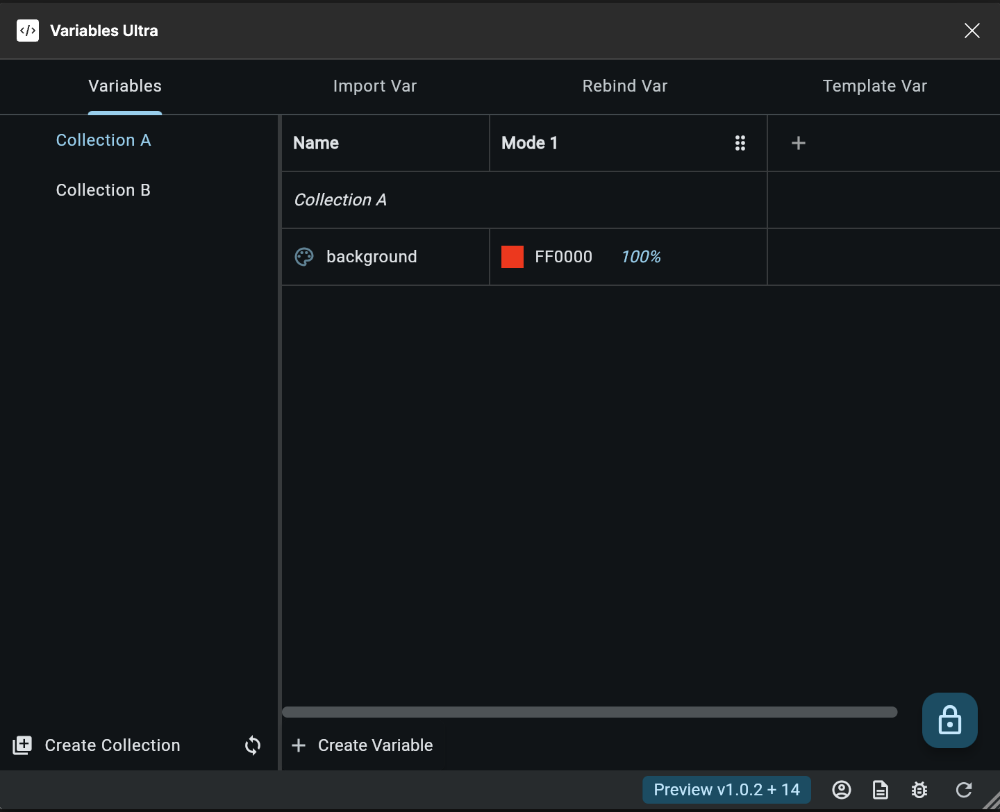

    2. Collection `Collection B` with a variable `background`.

       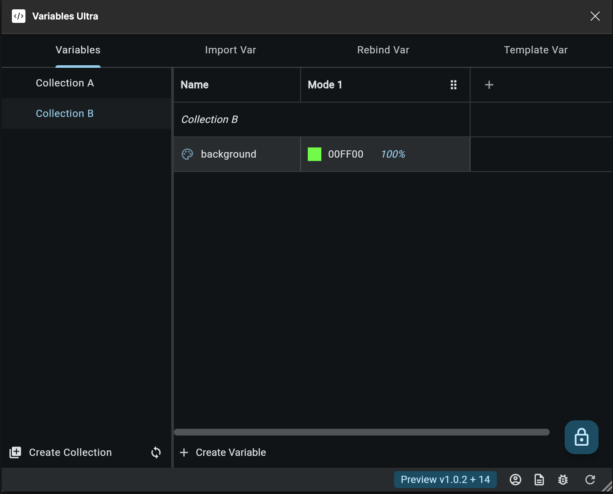

2. Select a layer and bind its fill to `Collection A` / `background`.

   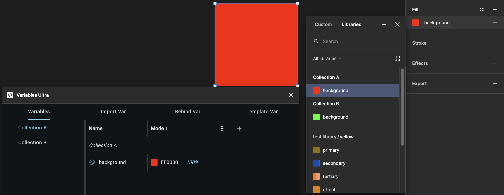

3. Open the plugin and go to the `Rebind Var` tab.
    - Choose the scope: `Selection`, `Current Page` or `All Pages`.
    - Set `Source Collection` to `Collection A` and `Target Collection` to `Collection B`.

   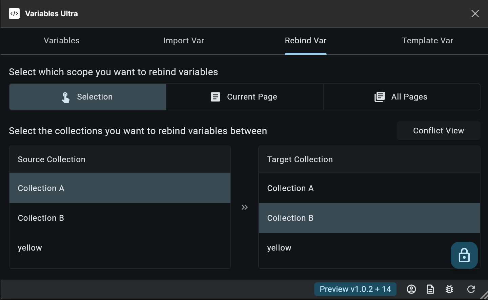

4. Press the rebind button at the bottom right. The layer's fill is now bound to `Collection B` / `background`.

   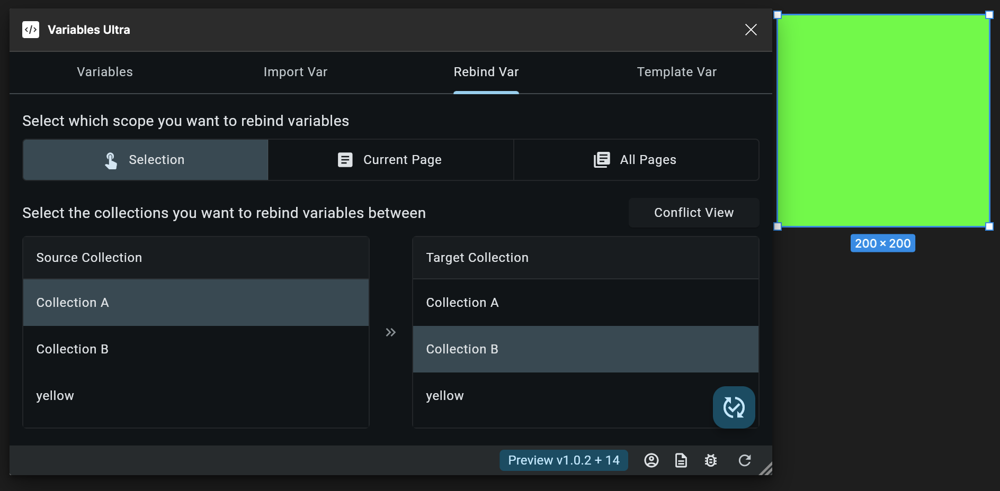

Rebinding walks through every nested layer in the scope and handles any number of variables.

### What gets rebound

- Solid and gradient fills and strokes
- Effects and layout grids
- Layer properties bound to variables, such as size, spacing, corner radius and opacity
- Text content, typography and fills on text ranges
- Collections from enabled team libraries can be used as the source or target

### Limits

- A fill set to `Mixed` can't be rebound.
- If a text layer binds a string variable to its content **and** binds variables on several text ranges, only the
  content is rebound; the per-range typography is skipped.

Anything that couldn't be rebound is listed in `Conflict View`, with the page, layer, field and reason. You can copy
the list to the clipboard.

## Import and export

Reuse variables across files without recreating them by hand.

### Export

1. On the `Variables` tab, press the save button at the bottom right.
2. The plugin saves `variables_data.json`, which contains every collection and variable in the file, including
   aliases between them.

For example, this `Shared Collection` links to variables in two other collections:

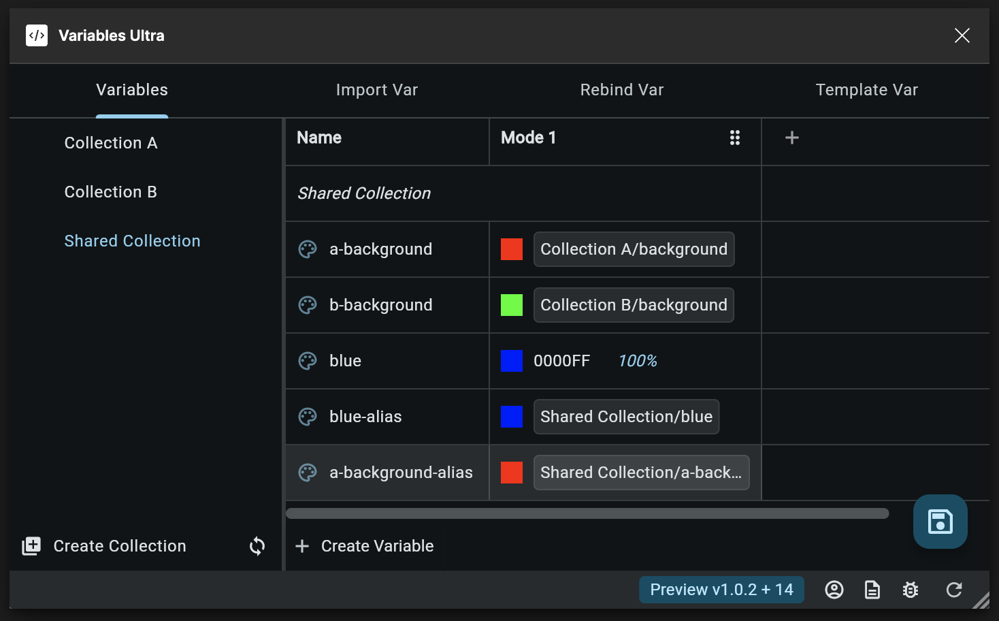

### Import

1. Open the target file, go to the `Import Var` tab and select the JSON file.

   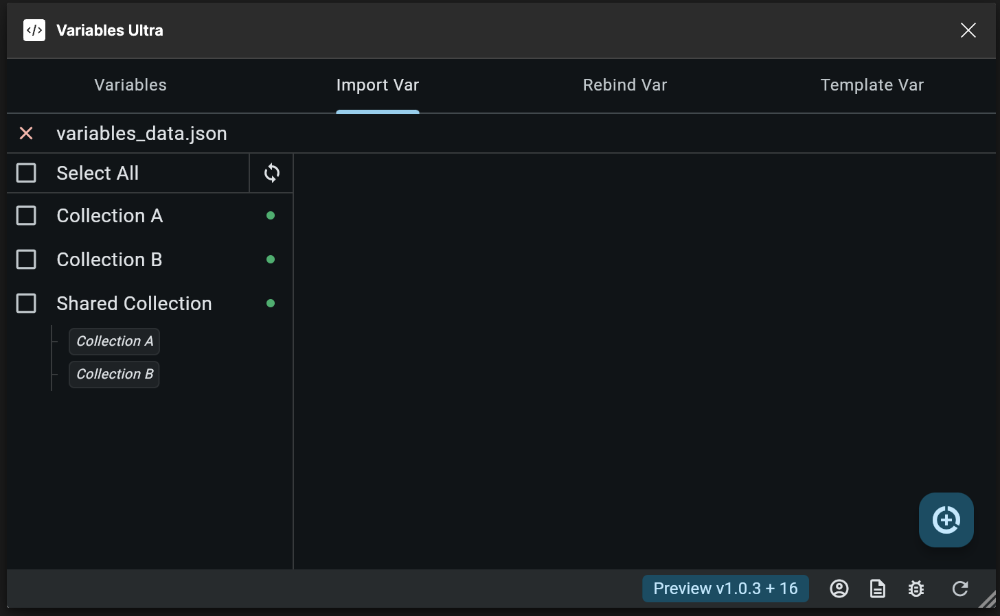

2. The plugin shows every collection in the file and how they depend on each other.
3. Select the collections to import. Collections they depend on are selected automatically.

   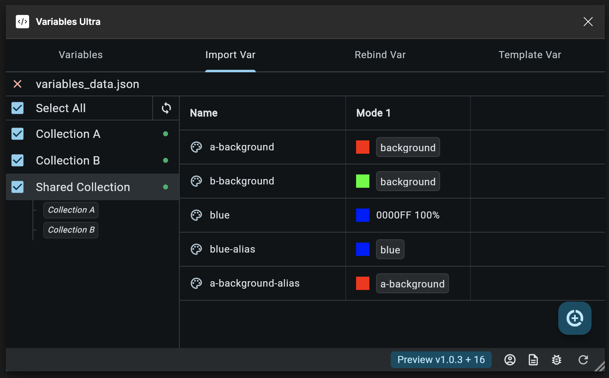

4. Press the import button at the bottom right.

   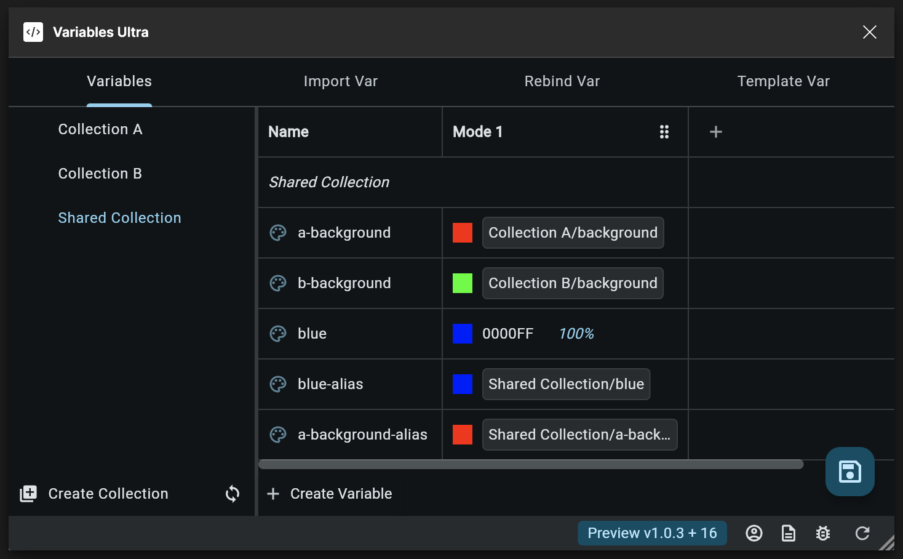

## Material 3 templates

Generate a full Material 3 color scheme from one seed color.

1. Go to the `Template Var` tab and pick a seed color.
2. Press the generate button at the bottom right and choose how to apply it:
    - **Create**: make a new collection (the name must be unique).
    - **Update**: update the variables that already exist in a collection you choose.
    - **Merge**: update matching variables and add the missing ones.

The generated collection has four modes: `Dark`, `Light`, `Light Medium Contrast` and `Light High Contrast`. Generate
several collections from different seed colors, then switch between them with [Rebind variables](#rebind-variables).

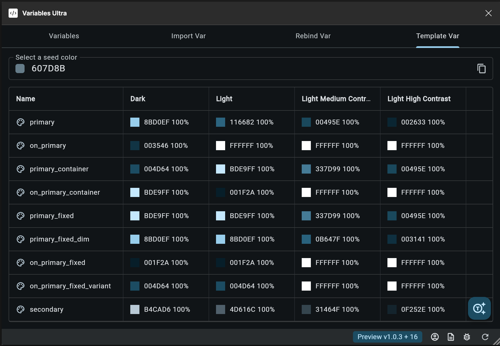

## Feedback

Found a bug or have an idea? [Open an issue](https://github.com/variables-ultra/variables_ultra_doc/issues).

## License

[MIT](LICENSE)
