# Variables Ultra

重绑定、导入导出 Figma 变量，并生成 Material 3 主题。

[English](README.md) | 中文

**Variables Ultra** 是一款免费的 Figma 变量管理插件。它覆盖了 Figma 自带变量面板的大部分功能，界面针对变量很多的情况做了优化，
还补上了 Figma 没有的几样工具：把图层从一个变量集整体换绑到另一个变量集、在文件之间搬运变量、生成 Material 3 配色主题。

- 所有功能免费，不需要注册或登录。
- 所有操作都在 Figma 里完成。导出的文件保存在本地，不会上传到任何地方。

## 目录

- [变量页](#变量页)
- [变量重绑定](#变量重绑定)
- [导入和导出](#导入和导出)
- [Material 3 模板](#material-3-模板)
- [反馈](#反馈)

## 变量页

打开插件就能浏览和编辑当前文件里的变量。

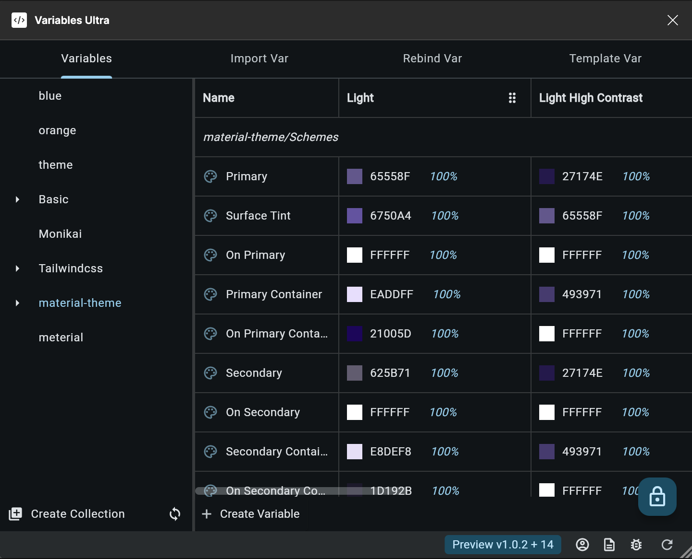

- 所有变量集并排显示在同一个视图里，切换时不用打开下拉框。
- 点击变量名前面的图标，查看或编辑变量详情。
- 支持单选、多选和全选。
- 把变量链接到另一个变量（别名）的操作更少。
- 可以一次修改多个变量的作用范围（scope）。

## 变量重绑定

把整个变量集当作主题来用。重绑定会把图层用到的变量，从一个变量集换成另一个变量集里对应的变量，所以切换主题不受 Figma 套餐里
mode 数量的限制。

变量按**名称**匹配：源变量集里的 `background` 会换成目标变量集里的 `background`。目标变量集里找不到同名变量的，保持不变。

### 示例

1. 创建两个变量名相同的变量集。
    1. 变量集 `Collection A`，包含变量 `background`。

       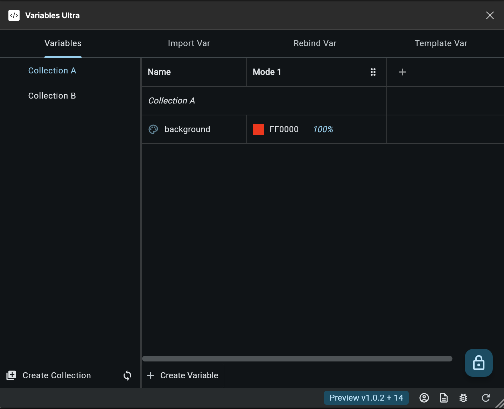

    2. 变量集 `Collection B`，包含变量 `background`。

       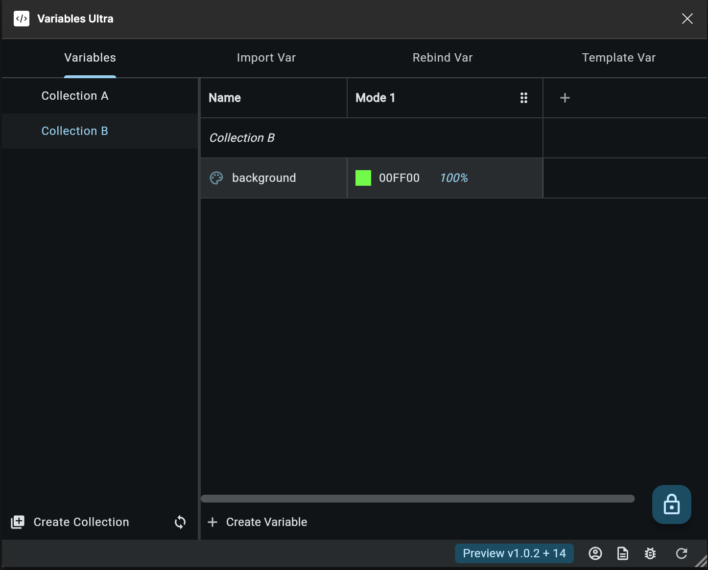

2. 选中一个图层，把它的 Fill 绑定到 `Collection A` / `background`。

   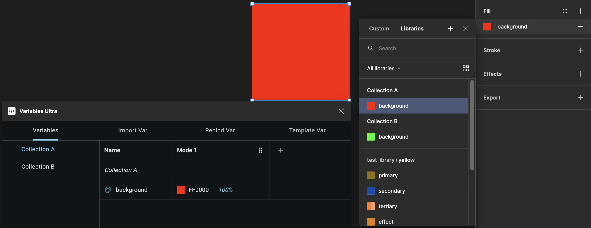

3. 打开插件，切换到 `Rebind Var` 标签页。
    - 选择范围：`Selection`（选中的图层）、`Current Page`（当前页）或 `All Pages`（所有页）。
    - `Source Collection` 选 `Collection A`，`Target Collection` 选 `Collection B`。

   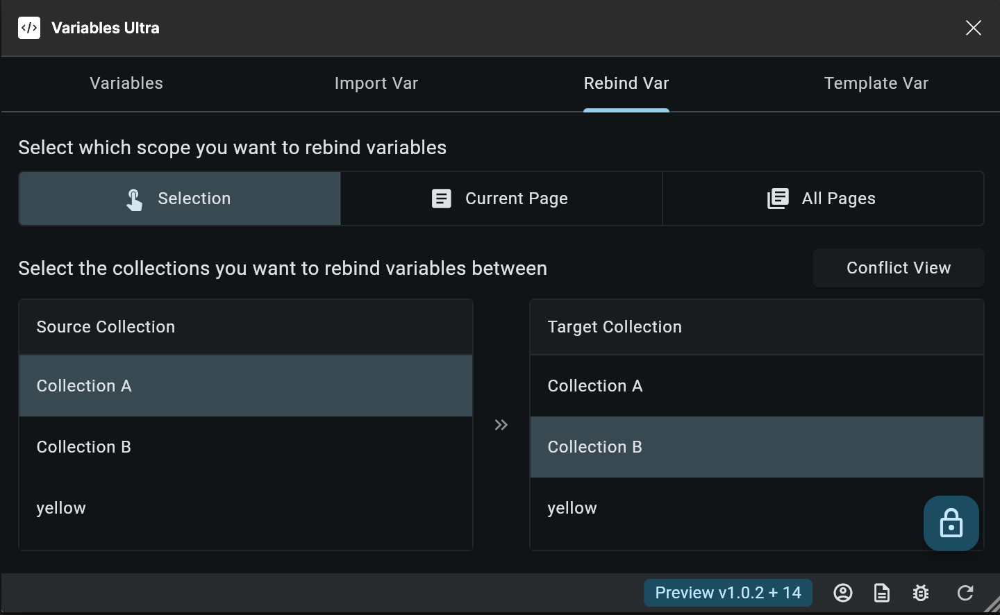

4. 点击右下角的重绑定按钮，图层的 Fill 就换绑到了 `Collection B` / `background`。

   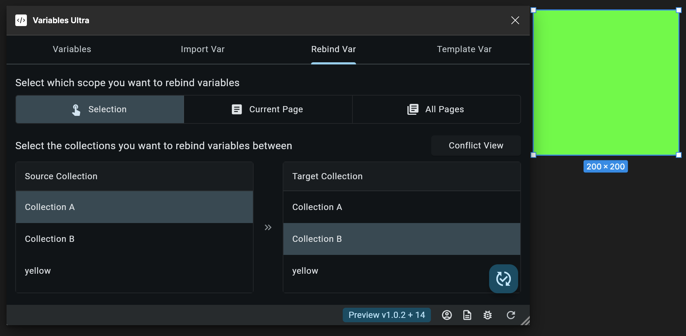

重绑定会遍历范围内所有嵌套的图层，变量数量不限。

### 支持重绑定的内容

- 纯色和渐变的填充、描边
- 效果（Effects）和布局网格（Layout grids）
- 绑定了变量的图层属性，比如尺寸、间距、圆角、不透明度
- 文本内容、文字样式，以及文本片段上的填充
- 源和目标都可以是已启用的团队库里的变量集

### 限制

- 值为 `Mixed` 的填充无法重绑定。
- 如果一个文本图层既把字符串变量绑定到了文本内容，**又**在多个文本片段上分别绑定了变量，只会重绑定文本内容，各片段的文字样式会被跳过。

无法重绑定的内容会列在 `Conflict View` 里，包括页面、图层、属性和原因，可以一键复制到剪贴板。

## 导入和导出

在多个文件之间复用变量，不用再手动一个个重建。

### 导出

1. 在 `Variables` 标签页，点击右下角的保存按钮。
2. 插件会保存一个 `variables_data.json`，包含当前文件里所有的变量集和变量，以及它们之间的别名关系。

比如下面这个 `Shared Collection` 链接了另外两个变量集里的变量：

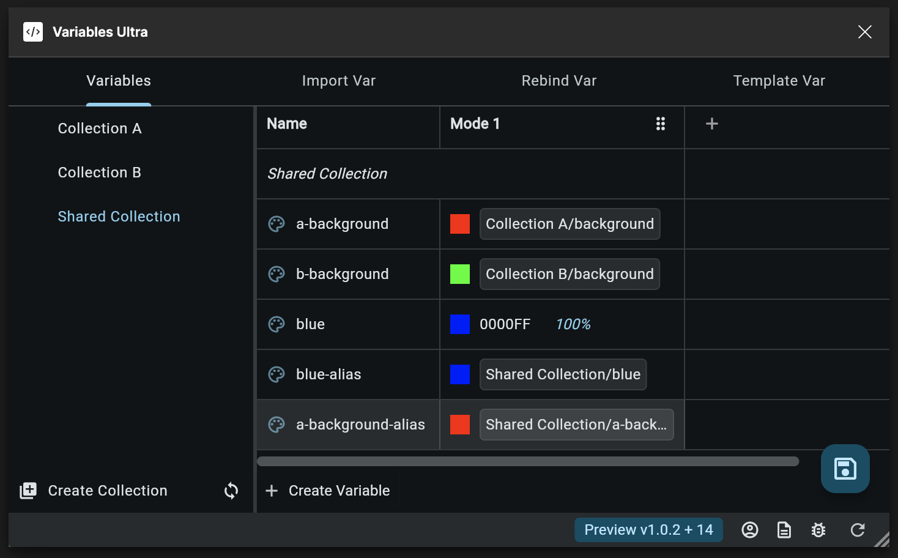

### 导入

1. 打开目标文件，切换到 `Import Var` 标签页，选择刚才导出的 JSON 文件。

   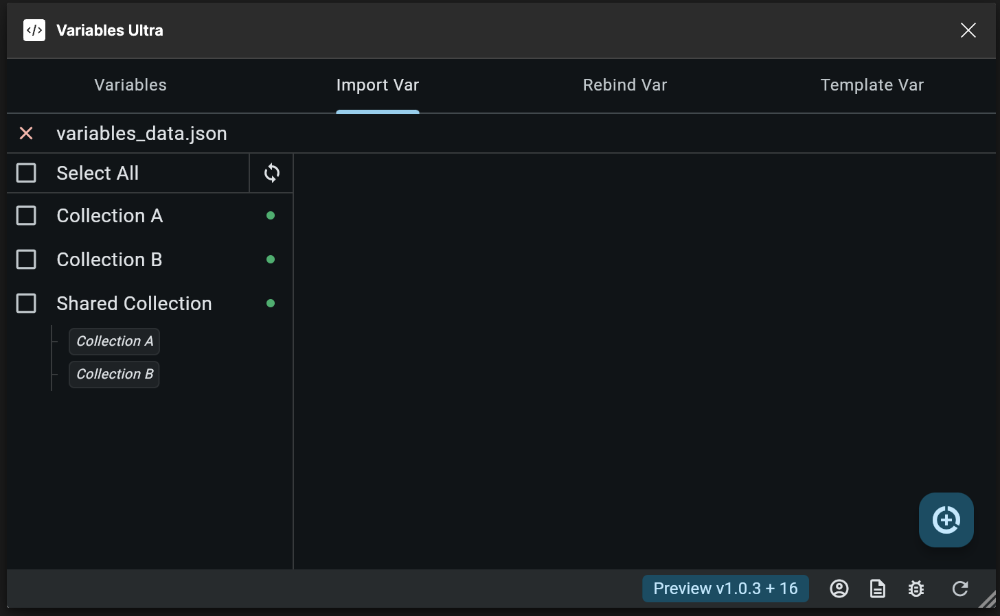

2. 插件会列出文件里所有的变量集，以及它们之间的依赖关系。
3. 勾选要导入的变量集，它们依赖的变量集会被自动勾选。

   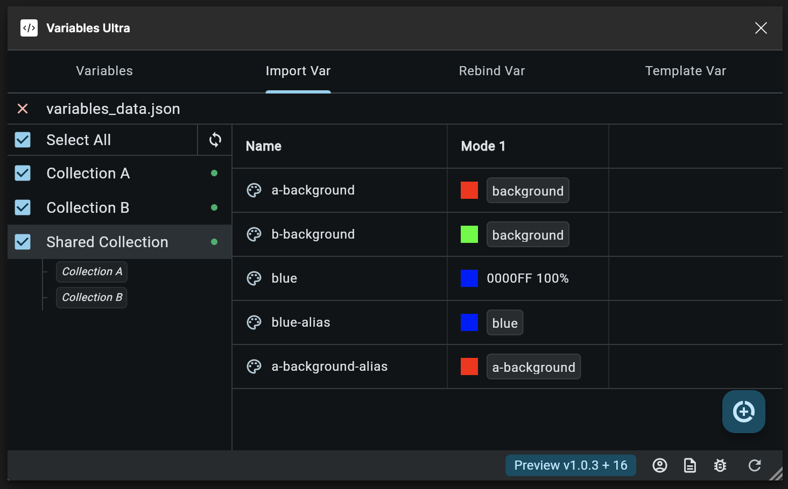

4. 点击右下角的导入按钮。

   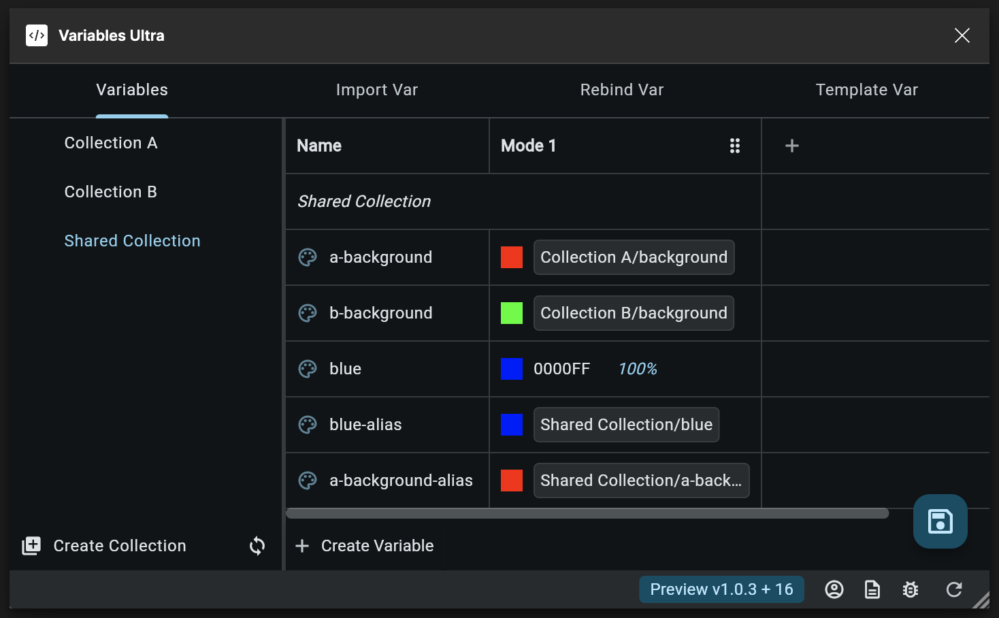

## Material 3 模板

选一个种子色，生成一整套 Material 3 配色。

1. 切换到 `Template Var` 标签页，选择种子色。
2. 点击右下角的生成按钮，选择生成方式：
    - **Create**：新建一个变量集，名称不能和已有的重复。
    - **Update**：只更新所选变量集里已有的同名变量。
    - **Merge**：更新同名变量，并补上缺少的变量。

生成的变量集包含四个 mode：`Dark`、`Light`、`Light Medium Contrast` 和 `Light High Contrast`。用不同的种子色生成多个变量集，
再用[变量重绑定](#变量重绑定)在它们之间切换。

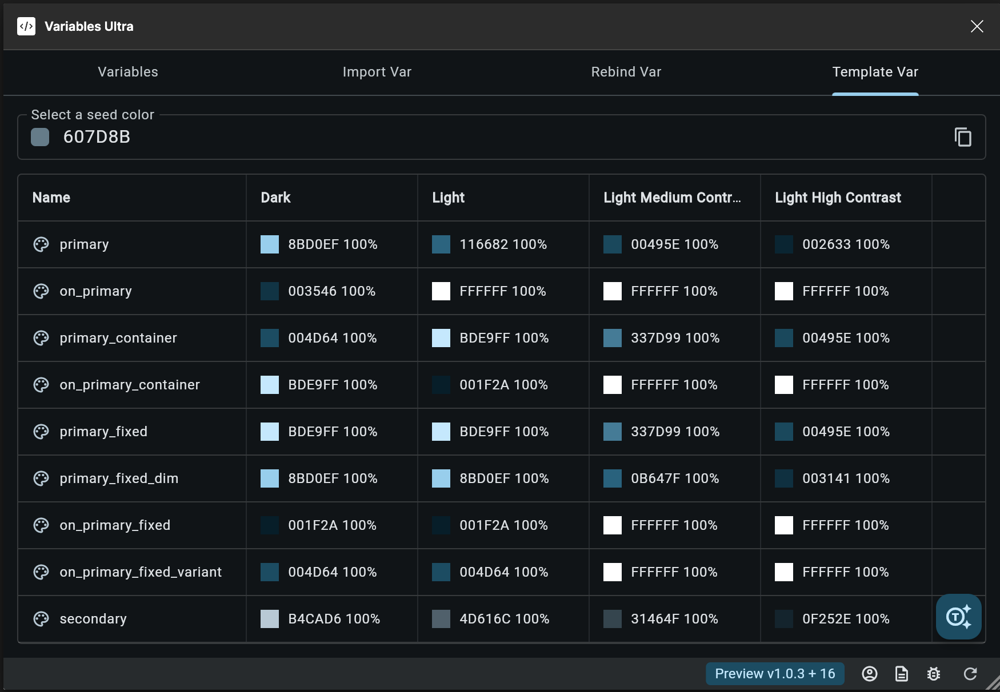

## 反馈

发现问题或有建议？欢迎[提交 issue](https://github.com/variables-ultra/variables_ultra_doc/issues)。

## 许可证

[MIT](LICENSE)
